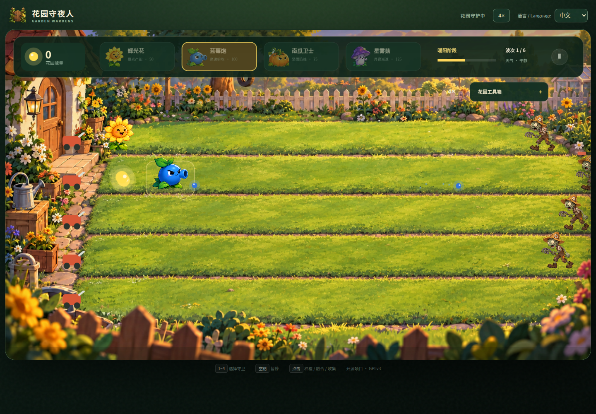

# Garden Wardens

[](https://github.com/marcelpetrick/garden-wardens/actions/workflows/ci.yml)
[](https://marcelpetrick.github.io/garden-wardens/)
[](https://github.com/marcelpetrick/garden-wardens/pkgs/container/garden-wardens)
[](LICENSE)
[](.nvmrc)
[](vitest.config.js)

[中文](README.md) · **English**

A maintained fork of [SynapShift/Garden Wardens](https://github.com/SynapShift/garden-wardens), a hand-painted browser tower-defense game built with Phaser and Vite. Five lanes, four wardens, six waves, plant fusion, day/night resonance, changing weather and energy-powered tools. Version **0.4.3**.

**[Play our latest validated build](https://marcelpetrick.github.io/garden-wardens/)** · No installation required.



## Play

Mandarin is the default on every page load. Choose **English** in the header to translate the page and the game immediately without restarting your match. The language choice lasts for the current page session.

- Click a card or press `1`–`4` to select a warden; click a lawn tile to plant.
- Plant the same warden on an occupied tile to fuse it (up to level 3).
- Click glowing energy orbs to collect them; use Garden tools for auto-collection, random gifts and firepower upgrades.
- Press Space or click the pause control to pause/resume.
- Click **1× → 2× → 4× → 1×** in the header or on the battlefield. Timers, animation and simulation speed change together; pause preserves the selected speed. A new game starts at 1×.
- Desktop mouse/keyboard and mobile touch are supported. The header language and speed controls also support keyboard focus.

Glowblooms produce energy faster in sunlight. Starshrooms fire faster at night. Phases last 32 game seconds; acceleration shortens their real-time duration. Weather can bring extra energy or faster projectiles. Adapt your formation across six increasingly difficult waves.

## Local setup

Use **Node 24.15+**, npm, and Git. `.nvmrc` selects Node 24.

```bash
nvm use                       # if nvm is installed
npm ci
npm run dev
```

Open **http://127.0.0.1:5173/**. For the production build:

```bash
npm run build
npm run preview
```

Open **http://127.0.0.1:4173/**. Both servers bind to loopback by default; add `-- --host 0.0.0.0` only when you deliberately want LAN access.

## Validation and development

Install Chromium for the browser suite once:

```bash
npx playwright install --with-deps chromium
./localPipeline.sh
```

A system Chromium is also supported: `CHROMIUM_PATH=/usr/bin/chromium ./localPipeline.sh`.
The full pipeline requires Docker Engine, Python 3, curl. It fails immediately when a stage fails and never silently skips Docker.

The gate checks formatting, ESLint, TypeScript configuration checks, Python script syntax, unit/integration scene tests with V8 coverage, npm vulnerabilities, the production build, desktop/mobile browser tests, and a Docker build plus the same browser tests against the running container. ESLint checks all JavaScript; TypeScript checks the tooling configuration and localization module. Deterministic scene tests isolate Phaser rendering; Playwright exercises the real production renderer. Coverage includes every `src/**/*.js` file and enforces at least 95% lines, statements, branches and functions. Generated reports are in `coverage/`.

```bash
npm run format       # apply formatting
npm run format:check # check only
npm run lint
npm run check
npm test
npm run build
npm run test:e2e
```

See [the script reference](docs/scripts.md), [security review](docs/security-review.md), and [vision checklist](visions.md). The optional Python artwork tools use exact versions in `requirements-assets.txt`; they are unnecessary to play, build or test the browser game.

## Docker

```bash
docker compose up --build -d
# Play at http://127.0.0.1:8080/
docker compose down
```

Or use the published image (authenticate with `docker login ghcr.io` and a token
with `read:packages` if the package is private):

```bash
docker run --rm --read-only --tmpfs /tmp --cap-drop ALL \
  --security-opt no-new-privileges:true \
  -p 127.0.0.1:8080:8080 ghcr.io/marcelpetrick/garden-wardens:latest
```

GitHub creates new GHCR packages as private. The owner can enable anonymous pulls
by setting the package visibility to Public in its GitHub package settings. CI
pulls the image back from GHCR and runs the full Docker browser suite with its
publishing credentials; publishing is verified even while the package is private.

Version tags (for example `0.4.3`) and full `sha-<commit>` tags allow selecting a specific build. The multi-stage image uses digest-pinned Node and unprivileged nginx, listens on 8080 and exposes `/healthz`. `/source.tar.gz` provides corresponding application source, including build scripts and lockfile; `/LICENSE` and `/LICENSES/upstream-MIT.txt` provide license notices. Runtime containers do not need Node or npm.

## CI, publishing and upstream contributions

[GitHub Actions](https://github.com/marcelpetrick/garden-wardens/actions/workflows/ci.yml) runs the same `./localPipeline.sh` for pushes and PRs. Only validated `main` pushes deploy to this fork's Pages site and publish to GHCR. Pull requests never receive publishing credentials. Actions and container bases are pinned by commit/digest. Superseded pipelines are cancelled to prevent older builds replacing the current deployment.

This fork develops independently of the original maintainer. The initial upstream stack is [security #4](https://github.com/SynapShift/garden-wardens/pull/4) → [language #5](https://github.com/SynapShift/garden-wardens/pull/5) → [speed #6](https://github.com/SynapShift/garden-wardens/pull/6). Those review branches preserve their feature snapshots; `main` is the maintained playable version. Until earlier PRs land upstream, later PRs have cumulative diffs. Future work should normally use feature PRs into this fork and offer suitable changes upstream separately.

Each commit bumps the patch version; a substantial feature bumps the minor version instead. Conventional commit messages describe the change, and the complete local gate passes before commit/push. See [CHANGELOG.md](CHANGELOG.md).

## License and credits

This maintained distribution is **GPLv3 or later**; see [LICENSE](LICENSE). Original Garden Wardens code and artwork are credited to SynapShift and the Garden Wardens contributors. Their original MIT copyright and permission notice is preserved in [LICENSES/upstream-MIT.txt](LICENSES/upstream-MIT.txt). Phaser and other third-party dependencies retain their own licenses. The stylesheet requests a Google-hosted font; no account or game backend is required.
